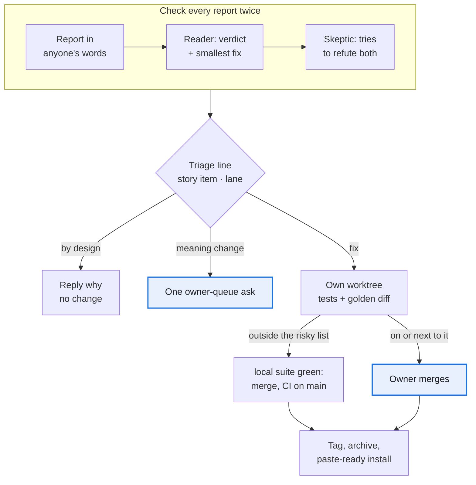
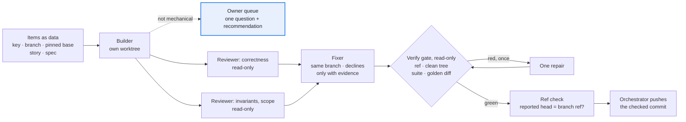
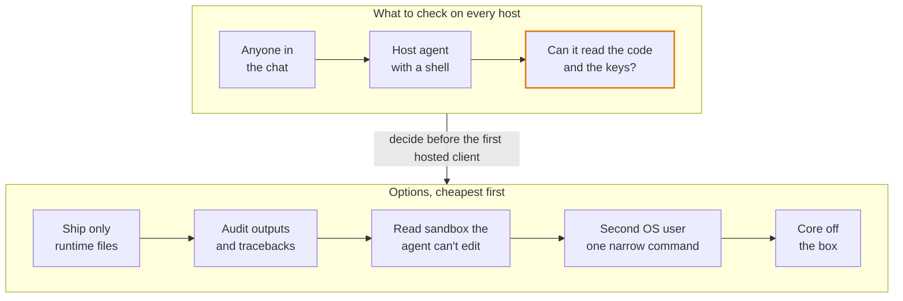

# Building and running with agents

Moved from the playbook's [README](../README.md) unchanged; the README keeps the overview.

## When agents file the issues

Most issues came from agents: those operating the skill pack, the client's own agent, demo runs and golden diffs. Most MRs merged on green CI; the owner's time went to meaning changes and risky merges.



1. **The triager, not the reporter, writes the first line:** the story item, the lane and how it was found ([checklist](../templates/triage-checklist.md)). Ship what changes no meaning now; queue the rule change as one question.
2. *Seen once:* **check every outside report twice: a reader, then a skeptic** ([prompts](../templates/verify-challenge.md)). Of the client's agent's 6 points, 2 were by design; the skeptic corrected 2 verdicts, and probing plus the golden diff found 3 more bugs. All 7 fixes merged the same day, one by the owner because it sat next to the gate relay.
3. **A batch that breaks the invariants is one owner decision, not N fixes.** *Paid for:* an outside team proposed a parallel app with its own config and data files in 20 issues, several writing values back around the gate. The owner closed all 20 as superseded: confirm-from-the-page already existed, built with one additive skill pack change.
4. **Merge on the local suite, check CI on main, except the risky list** (what is merged is a milestone, rule 8) ([protected paths](../templates/CODEOWNERS)). Before merging, the agent merges current main into its branch and runs the whole local suite (and the golden diff for a refactor) on that result; green means merge, without waiting for the MR's pipeline. The pipeline on main then checks a clean environment: the agent looks at it right after and, if it is red, fixes forward or reverts the merge at once and tells the owner (DORA: tests run before and after the merge, a broken build is fixed or reverted within minutes; Fowler's "Continuous Integration": the reference build runs somewhere other than the developer's machine). Still waiting for the MR's own pipeline: the risky list, the CI config and dependency pins, anything that depends on the OS, the interpreter version, signals, a tty, file modes or case-sensitive paths, a schema change, and a run where the local suite was incomplete or flaky. On the forge's free tier nothing blocks the merge: the agent reads the list. A refactor that moves risky code adds the new file to the list in the same MR; this was missed once. *Paid for:* the SEO skill pack's CI took 2 to 2.5 minutes per MR on shared runners and 16 shards instead of 8 did not shorten it (the runner CPU was the limit); of 300 pipelines 9 failed, 8 with a test the local run shows too, 1 only in the CI container (a signal exit code), and the one red main came from a merge that no MR pipeline could have seen.
5. **Refactors pass a committed golden diff** ([spec](../templates/AGENT_INSTRUCTIONS.md#golden-diff), [engine](../templates/tests/golden/)). *Paid for:* the first golden scripts lived in a session's scratch space and vanished with it; on real data the committed tool caught a report that differed in 45 places between two runs of the same code. Before its 0 could be trusted, it needed clocks pinned in the verbs' own child processes, only real noise masked, an untorn copy of a live folder, and worktrees removed on a kill.
6. **Nothing a later session needs lives only in a session** ([rules](../templates/AGENT_INSTRUCTIONS.md#what-lives-here)). *Paid for:* a scratch directory was wiped once, and the queue page's database still held all 213 review rows; one session left 108 worktrees.
7. **A rule learned on one client stays proposed until a client with another business model confirms it.** Every client handoff ends with a Distil list: each insight goes to a skill pack issue or MR, a proposed story or policy, or is marked client-only ([handoff](../templates/session-handoff.md#session-end-checklist)). *Paid for:* an SEO skill pack built on a B2B manufacturer shipped its page recipes with the pump's spec columns in them, and a URL-pattern order that typed 266 pages on three clients wrongly; both showed only when the first web-shop client arrived.
8. **Integrate by milestone, not by step.** A milestone is a row of the roadmap's optional Milestones section ([format](../kit/guards/roadmap.py): its items and its closing proof, at most three open); an item is a commit, and a milestone is what reaches main. (a) One branch per milestone, one commit per item; every commit leaves the whole local suite green; a refactor never shares a commit with a behaviour change, and a refactor's golden diff runs against its own parent. With many builders ([roadmap](roadmap.md#executing-it)) each builder's branch is merged into the milestone's branch by the coordinator, not into main. (b) No merge request until the closing proof is green on the milestone's branch: the whole suite, the golden diff of the refactor commits, the checks the milestone names (its stories' proof commands). Push earlier only as a backup, and without a pipeline (`git push -o ci.skip` on GitLab). (c) One merge request per milestone, its title naming the milestone and its description listing the items with their proof; merged by rule 4, then the pipeline on main. (d) An MR before the milestone closes only for: a question that is the owner's about work in progress (open it as a draft), a fix a client is waiting on, or a change on the risky list. (e) A milestone that passes about ten items or two weeks splits at a point where something can be used. (f) The CI runs for merge requests, the default branch and tags, never for each push to a branch ([template](../templates/gitlab-ci.yml)). *Paid for:* the video-ads skill pack opened five merge requests in two days for one restructure, three of them stacked on each other, and each waited for a pipeline whose result the local suite and the golden diff had already given; the last one alone carried all of them.

## Building with many agents

The source project built most of its changes with workflow scripts: many agents, one branch each, and one orchestrating session that pushes. About half of its runs rewrote the same script, schemas and prompt rules, and the early copies were missing rules that later cost rework. The loop, its result schemas and its rules are in [`templates/workflows/`](../templates/workflows/). Copy them on day one. *(untried as copied here: the scripts are the source project's made generic, and they are tested under a simulator, not yet run live in this form.)*



1. **Items are data, and the base is a pinned commit.** Each item names its key, branch, story and spec. Every prompt names the base SHA and an in-flight map: other branches and sessions, the files not to touch, and the one item that may bump a schema in this run. *Paid for:* two branches built at the same time both bumped the schema version to the same number.
2. **Show each new test red on the base, then green. Write each safety check both ways: the bad case refused AND the good one accepted.** *Paid for:* a reviewer found a new check that could not fail on the base, although the builder had reported that it did.
3. **Give each agent its own temp dir, port block and store, and run golden cases alone.** *Paid for:* test sandboxes leaked into the system temp dir while many agents ran the suite, and a timing check failed only while a golden compare ran beside it.
4. **A builder that meets a question of meaning stops.** It commits nothing and returns one question with its recommendation. *Paid for:* early scripts had no way to stop, so a builder guessed, and the owner's answer cost a rework.
5. **The fixer writes only where it may, and nobody trusts a reported commit.** A later agent cannot edit another agent's worktree. It enters that worktree first, or it fixes in its own detached worktree and moves the branch with a compare-and-swap, `git update-ref refs/heads/B NEW OLD`. Results carry `head_sha`, and the gate and the [ref check](../templates/workflows/refcheck.py) compare it with the branch ref before any push. *Paid for:* this write-hook trap came back run after run. Once a fix was left on a detached HEAD while the branch kept the unreviewed commit, and it was reported as done.
6. **Every item ends at a read-only gate with at most one repair round.** *Paid for:* early scripts ended at the fix pass, so "green" was only the fixer's word. The gate was cheap, and in later runs it never needed its repair round.
7. **Before a clean-up round, sweep read-only and send a skeptic after each candidate** ([`sweep-skeptic-plan.js`](../templates/workflows/sweep-skeptic-plan.js)). A finding nobody reproduced is not a finding. Accepted limits are listed up front, so they stop coming back. *Paid for:* in one refactor sweep the skeptics refuted several candidates before anyone built them. The survivors became small MRs with one reason each.
8. **Plan for restarts.** Copy the run's journal and script into the new session and resume. Finish a cut-off builder in its existing worktree ([how](../templates/workflows/README.md#after-a-restart)). *Paid for:* the orchestrating session restarted mid-run, and the running workflows were marked stopped.
9. **Put the owner's threat model in every reviewer prompt, and stop when only out-of-model findings remain** ([R14](../templates/workflows/README.md#the-rules-pasted-into-prompts)). Say what the guard defends against and what is out of scope (for a human gate: accident and habit, not a forging agent running as the same OS account; that account is the boundary); a finding outside it is an accepted limit (R11), not built. *Seen once:* review rounds of the SEO skill pack's approval tiers (S46) kept adding seals and locks against hand-forged files, though its gate guards against accident, not forgery.

The full rules table, with what each rule prevented, is in [`templates/workflows/README.md`](../templates/workflows/README.md#the-rules-pasted-into-prompts).

## Where worktrees live

A worktree is a peer of the checkout, never a child of it. One layout, the same name on every machine and in every skill pack:

```text
<parent>/<repo>/                   the checkout, kept on main: it pulls and reads, nobody works in it
<parent>/<repo>_worktrees/<name>/  one worktree per session, a sibling folder; <name> is the branch with "/" as "-"
```

1. **Create and remove them with git, from the checkout.** `git worktree add ../<repo>_worktrees/<name> -b <branch> origin/main`; `git worktree list`; `git worktree remove ../<repo>_worktrees/<name>` once merged; `git worktree prune` for entries whose folder is gone. If a checkout or worktree folder is renamed or moved, `git worktree repair` (run in the main worktree, or in the moved one) reconnects it; `git worktree move` moves a linked one cleanly.
2. **Nothing under the checkout.** No `.claude/worktrees/`, no `worktrees/` inside the repository. *Paid for:* a session started in `<repo>/.claude/worktrees/<name>` read the checkout's `CLAUDE.md` as well as its own (instruction files are read up the directory tree). The checkout sat on a stale branch, so the two copies, 12.6 KB and 8.3 KB, disagreed and cost 21 KB of context in every session. Editors, file watchers, test discovery and lockfile detection also walk into a nested worktree (reported against Claude Code's default), and the layout needs a `.gitignore` line to keep `git status` clean.
3. **Why a sibling folder named `<repo>_worktrees`.** The git manual does not fix a location; its own examples are siblings (`../hotfix`, `../temp`). Claude Code's default is nested (`.claude/worktrees/<name>`, with a `.gitignore` tip), and users have asked for a sibling default. Tools and write-ups that group worktrees use one sibling folder per repository (`<repo>-worktrees/<branch>`, `<repo>.worktrees/`). We take the underscore: the folder sorts next to the repository, and it cannot be mistaken for a repository called `something-worktrees`. A name per branch (`<repo>-<branch>` as direct siblings) fills the parent folder with project-named folders once there are twenty sessions.
4. **Tell the tool.** Claude Code in the desktop app: Settings → Claude Code names where new session worktrees go (the default is inside the project); choose a folder outside it. Claude Code on the command line: a `WorktreeCreate` hook may place worktrees elsewhere (it replaces the default logic, so it must run `git worktree add` itself), or create the worktree with git as above and start `claude` inside it. Expect an approval prompt when a session enters a worktree outside `.claude/worktrees/`.
5. **Check it.** `git worktree list` shows no path under the checkout; a worktree whose branch is merged is removed the same week ([rule 6](#when-agents-file-the-issues): one session once left 108).

Sources (names, not links: the playbook links no outside site): the git manual, `git worktree`; Claude Code's documentation, "Run parallel sessions with worktrees"; two Claude Code issue reports, one asking for a sibling-folder default and one on nested worktrees confusing editors and build tools.

## Keeping a skill pack small as it grows

*Seen once:* the video-ads skill pack reached about 40,000 lines and 42 verbs in its first weeks. No module was dead; the cost was repetition and drift. The step that closed its loop (results back to the insight they tested) had no home of its own, and a newcomer agent had to read the code to finish ordinary tasks. The owner chose to slim it before adding anything. Three methods came out of that, each seen once.

1. **Slim before features.** Inventory the skill pack by stage of its loop: lines per module per stage, and what serves no stage. Give each concept one home and derive the rest. Park what lies outside the loop in a `_parked/` folder: no verb reaches it, nothing imports it, no doc describes it and no test runs it, and its README says how to bring each piece back (move the module, re-add the verb and its doc, restore the tests from history). Code nobody will want back is deleted; history keeps it. Take no new features while slimming, so each cut is held against a fixed target. *Seen once:* whom a creative serves was written in 9 places on three kinds of file and drifted; it now lives in 1, and the other 8 are derived. The same inventory found one ask-and-record routine written three times, a money formatter copied six times, about 10 page renderers drawing much the same thing and the pipeline told in five or six documents.
2. **Code filters; the agent judges.** Audit every place where code makes a call an agent should make. Code applies the bans, bounds and counts and lists the allowed candidates with their facts, unranked. A skill picks one and writes a `why`; code then checks that the pick is an allowed candidate and that the `why` is there, and refuses otherwise. No canned first drafts filled from fixed text, and no hard-coded interview waves: the agent drafts from the sources and asks about the exact items it is unsure of. *Seen once:* the audit found seven such calls in code: a template first draft, three waves of fixed questions, a fixed ranking that chose the next test, guessed coding dimensions with a recode loop, thresholds deciding what reached a person, a score for where a new reference belonged, and a rewrite by name swap. Handing them to the agent, with the dead weight cut beside them, removed about 3,100 lines of code and 1,800 of tests (gross, from the two merges' diffstats). **The other way round holds too:** a mechanical check that lives only in an agent's prompt (is each link live, no banned markup, a length) belongs in code, as a read-only verb the prompt runs and whose coded warnings it trusts. The prompt keeps only the judgement (is this the right page for the sentence, is the maths right). A check in a prompt runs only when the agent remembers it, and no test fails when it is dropped. *Seen once* (the SEO skill pack, 2026-10-13): it moved its blog workflow's link, markup and length checks out of the fact-check prompt into `seo apply shopify check --file` (`scripts/apply_shopify.py`, `templates/client/.claude/workflows/blog-wave.js`; `tests/test_apply_shopify.py`); the same check runs inside every draft and publish, so the owner's one-step publish mode refuses a dead link.
3. **A newcomer-agent acceptance test.** Give a fresh agent only the repository and four real tasks a user brings: find whether something already exists, make the next piece of work, take in new numbers, and say what it must never do. It reports where it succeeded, where it was confused, where it had to read code, and any hazard. Rank what it tripped on, fix the top of the list, and run the same four tasks with another fresh agent. This tests usability; the replay in the [client handoff](../templates/client-handoff.md) (rule 4) tests the deliverable. *Seen once:* the first run found no documented route for the commonest task, a loop the README showed as working that stopped half way, no read-only way to list the candidates, the never-do rules spread over five places, and a relink that would silently move work already delivered to another target. The re-run after the fixes found smaller gaps, fixed the same day.

## Long or paid runs, and the rehearsal before a demo

*Seen once:* the product-keyframe-video skill pack's demo path (a jobs file, run on a rented GPU, ending in a results page). The first rehearsal passed and listed two stuck points; a review of the same tools afterwards found four more, each reproduced, because the rehearsal had only walked the happy path.

1. **A tool that runs many items, or spends money per item, keeps its record per item.** It writes the record after each item, so a failure later cannot take the earlier ones; it records a failing item with its reason and goes on with the rest; it exits non-zero when any item failed; a selector (`--only`) that matches nothing is an error, not an empty run; and a file that records paths records them relative to its own folder.
2. **Rehearse on the real stack before a client sees it, and break it on purpose.** Time each step, list where the operator got stuck or worked by hand, and turn each into an issue. Then run the failures a happy path never meets: one item failing, a mistyped argument, a relative path, a rerun of one item alone. A fix gets a test that fails on the old code.
3. **Freeze for the demo, with named exceptions.** Fix one commit, take only blockers and only through issues, and when the owner allows a change in, record it with its commit in the roadmap. A frozen pack that cannot take a one-line fix is a schedule risk of its own.

## Hosting: the agent that runs it can read it

A hosting platform runs the skill pack under a remote agent that clients chat with. The adapter and per-client boundaries held; keeping logic and keys away from that agent must be decided per host, before the first hosted client.



1. **The core never names its host.** All host glue lives in one adapter folder; delete it and the skill pack still runs, and CI smoke-tests each supported platform version. *Paid for:* applying one review by the platform's team added about 850 lines: declared config defaults were never applied, and the linked command was not on the agent's PATH.
2. **One client = one data folder = one host agent.** No fallback to the working directory; on a host, turn off any user-wide env file, and let the doctor name each value's source. *Paid for:* agent shells reset the working directory, scattering credentials, database and raw files. The platform put every chat channel into one agent session, so a second client needs a second host.
3. **Check what the agent a client chats with can read, and what the host can write.** On the first host we checked, the agent ran as the skill pack folder's OS user with no deny rules, so it could read the code and the secrets file. Behaviour rules and settings the agent can edit are no barrier. Ask again on every new or replaced host agent ([checklist](../templates/install-checklist.md#new-host-or-a-replaced-host-agent-what-can-it-reach)), and pick a barrier above before the first hosted client.
4. **Scheduled tasks are closed prompts; long jobs run detached** ([checklist](../templates/install-checklist.md#scheduled-tasks-and-long-jobs)). *Paid for:* a laptop cron job failed silently, then its replacement exited 1 every hour and nobody saw it; a 30-day pull took close to an hour against a tool-call limit of about 10 minutes.
5. *Seen once:* **the console sits behind a proxy login that strips, then sets, the user header,** trusted only from loopback. After each restart: local 200, public 401, public with a forged header 401. *Paid for:* the platform's route declaration would have published the confirm inbox with no login.
6. *Seen once:* **client data moves by snapshot, and a push queue has one reader.** Stop the old consumer, then take a checksummed snapshot with row counts: confirmed values and approvals can't be pulled again. Two readers each get a random half, so a host swap has a deadline, the queue's retention.
